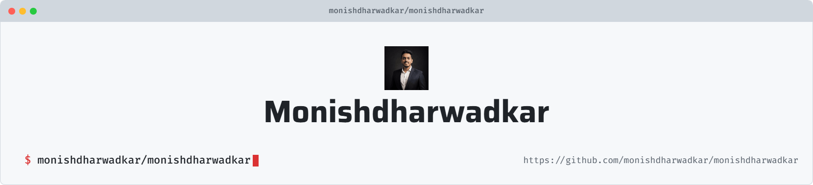

<!-- ==================== HEADER BANNER ==================== -->

  <picture>
     <source media="(prefers-color-scheme: dark)" srcset="art/header-dark.png">
     
  </picture>

  <h1>Hey there, I'm Monish Dharwadkar 👋</h1>

  

    

  
  

    

  

    <em>Engineering reliable systems, exploring intelligent automation, and building things that matter.</em>
  

  
  
  

  

---

<!-- ==================== ABOUT ME ==================== -->

<h2 align="center">⚡ About Me</h2>

  

<h3 align="center">Hey, welcome to my corner of GitHub!</h3>

  I'm <strong>Monish Dharwadkar</strong>, an Associate Software Engineer
  passionate about backend engineering, distributed systems,
  cloud-native infrastructure, and practical AI applications.

  💻 **Profession:** Associate Software Engineer

  ⚙️ **Building with:** Go, Python, REST APIs & Microservices

  ☁️ **Infrastructure:** Docker, Kubernetes, CI/CD & Ansible

  🤖 **Exploring:** Agentic AI, LLMs, RAG & AI-powered developer tools

  📊 **Observability:** Grafana, Kubernetes telemetry & production debugging

  🌱 **Learning:** System design, scalable architectures & AI engineering

  🎭 **Beyond tech:** Dance, cricket, volleyball & discovering great food

  I enjoy solving real-world engineering problems, improving system reliability,
  and turning ideas into production-ready solutions.

---

<!-- ==================== TECH STACK ==================== -->

<h2 align="center">⚡ Tech Stack & Tools</h2>

  <h3>Languages</h3>

  

    

  <h3>Backend & Frontend</h3>

  

    

  <h3>Databases & Infrastructure</h3>

  

    

  <h3>AI, Cloud & Developer Tools</h3>

  

    

  
  
  
  

---

<!-- ==================== GITHUB STATISTICS ==================== -->

<h2 align="center">⚡ GitHub Statistics</h2>

  

    

  

    

  

---

<!-- ==================== CONTRIBUTION ACTIVITY ==================== -->

<h2 align="center">⚡ Contribution Activity</h2>

  

  A visual overview of my GitHub contribution activity.

---

<!-- ==================== CONNECT ==================== -->

<h2 align="center">⚡ Let's Connect</h2>

  Have an interesting idea, an engineering challenge, or a project to collaborate on?
  Let's connect!

  

  

---

<!-- ==================== FOOTER ==================== -->

  <h3>🔥 Thanks for stopping by!</h3>

  

    <em>Keep building. Keep learning. Keep making an impact.</em>
  

  

  Designed with ❤️ by Monish Dharwadkar

